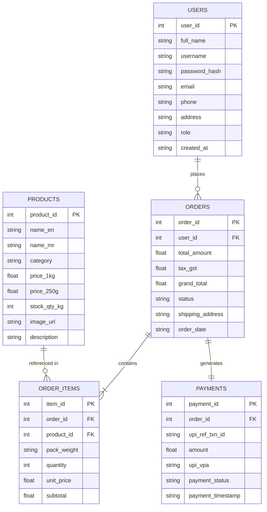
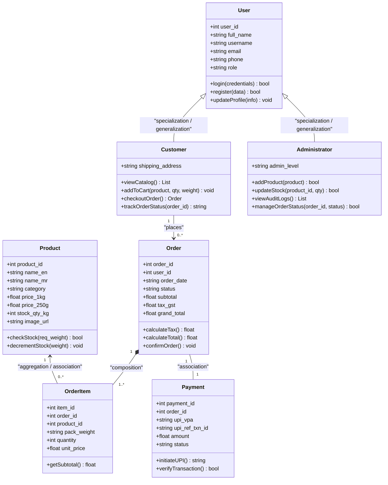
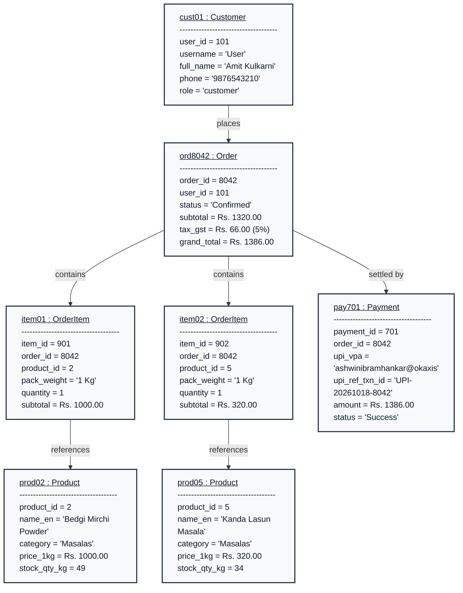
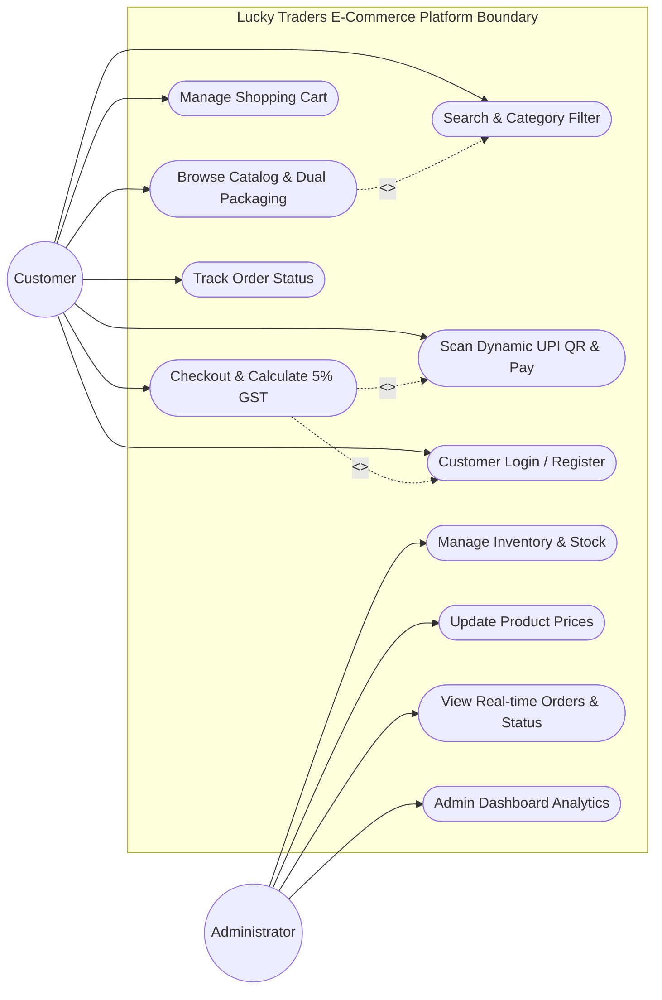
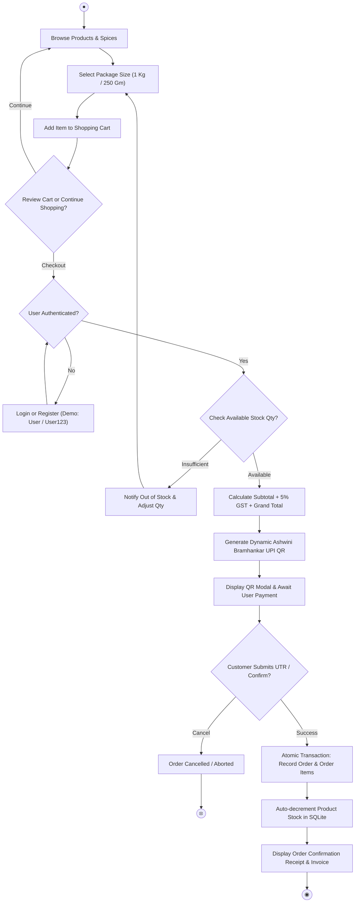
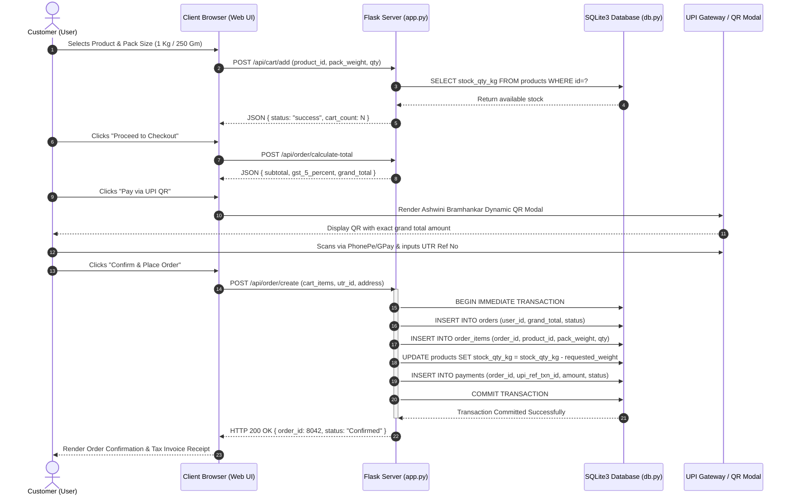

# Lucky Traders E-Commerce System
## Unified Modeling Language (UML) & System Architectural Specification
**Course / Syllabus:** SPPU B.E. / B.Tech Computer Engineering Final Year Project (CS331FP)  
**Project Title:** Lucky Traders - Authentic Maharashtrian Spices & Homemade Condiments  
**Technology Stack:** Python 3.13, Flask Framework, SQLite3 Database, Jinja2, HTML5/CSS3/ES6, Dynamic UPI QR Gateway  
**Document Companion:** [`PROJECT_UML_DIAGRAMS.pdf`](file:///c:/Users/lalit/OneDrive/Desktop/New%20folder%20(2)/Bhukkad/PROJECT_UML_DIAGRAMS.pdf)

---

## Executive Summary & Index of Diagrams

This document and its companion PDF provide the complete formal architectural model and object-oriented software engineering diagrams for the **Lucky Traders** e-commerce application. Each diagram strictly aligns with the Savitribai Phule Pune University (SPPU) curriculum guidelines for software modeling, object-oriented analysis, and database design.

| No. | Diagram Name | UML Classification | Architectural Focus |
|---|---|---|---|
| **0** | [Entity-Relationship (ER) Diagram](#0-entity-relationship-er-diagram) | Data Modeling | Relational schema, primary/foreign keys, cardinalities, normalization (3NF) |
| **1** | [Class Diagram](#1-class-diagram) | Static Structural | Object classes, attributes, methods, inheritance, composition, and associations |
| **2** | [Object Diagram](#2-object-diagram) | Static Structural | Concrete runtime snapshot of objects, attribute values, and links during checkout |
| **3** | [Component Diagram](#3-component-diagram) | Implementation Structural | Modular software components, provided/required interfaces, subsystem boundaries |
| **4** | [Deployment Diagram](#4-deployment-diagram) | Physical Structural | Physical/virtual nodes, runtime environments, network protocols, artifact deployment |
| **5** | [Use Case Diagram](#5-use-case-diagram) | Behavioral | Actor-system interactions, system boundary, `<<include>>` and `<<extend>>` relationships |
| **6** | [Activity Diagram](#6-activity-diagram) | Behavioral Process | End-to-end business workflow, decision branching, validation, inventory decrement |
| **7** | [Sequence Diagram](#7-sequence-diagram) | Interaction Behavioral | Chronological message sequence across client, web server, database, and UPI gateway |

---

## 0. Entity-Relationship (ER) Diagram

### Theoretical Background & Purpose
The Entity-Relationship (ER) diagram models the persistent relational data storage of the Lucky Traders application. The database is implemented using **SQLite3** (`lucky_traders.db`) and structured in Third Normal Form (3NF) to eliminate data redundancy, prevent insertion/update/deletion anomalies, and enforce strict referential integrity.

### Mermaid Diagram


### Relational Schema & Cardinality Specifications
1. **USERS (`1`) to ORDERS (`0..*`)**: One user can place zero or multiple orders over time. Each order is placed by exactly one registered user (`user_id` Foreign Key).
2. **ORDERS (`1`) to ORDER_ITEMS (`1..*`)**: An order contains one or more line items. If an order record exists, it must encapsulate at least one order line item (Existence Dependency).
3. **PRODUCTS (`1`) to ORDER_ITEMS (`0..*`)**: A product can appear in multiple order items across different customer orders.
4. **ORDERS (`1`) to PAYMENTS (`1`)**: Exactly one payment transaction is linked to each order record for UPI audit trails.

### Normalization Justification (3NF)
- **1NF**: All table attributes are atomic. Dual packaging (`price_1kg` and `price_250g`) are distinct numeric scalar columns rather than repeating groups or comma-separated lists.
- **2NF**: No partial dependencies. In `ORDER_ITEMS`, each line item uses a surrogate primary key (`item_id`), and all non-key attributes depend wholly on the candidate key.
- **3NF**: Zero transitive dependencies. Customer shipping addresses and order amounts are stored in their respective operational tables, preventing non-key fields from determining other non-key fields.

---

## 1. Class Diagram

### Theoretical Background & Purpose
The Class Diagram captures the static structure of the object-oriented Python backend. It illustrates domain entities, controller handlers, service classes, attributes, methods, and OOP principles including inheritance, encapsulation, and composition.

### Mermaid Diagram


### Key OOP Principles Demonstrated
1. **Inheritance / Generalization (`User <|-- Customer`, `User <|-- Administrator`)**: Common authentication attributes (`user_id`, `username`, `email`, `role`) reside in base class `User`. `Customer` adds checkout and cart capabilities, while `Administrator` encapsulates inventory control and order dispatching.
2. **Composition (`Order *-- OrderItem`)**: Strong lifecycle dependency. An `OrderItem` cannot exist independently of an `Order`. Deleting an order cascades to its items.
3. **Encapsulation**: Business logic methods such as `Product.decrementStock()` and `Order.calculateTax()` keep internal calculation and validation rules bundled with their state data.

---

## 2. Object Diagram

### Theoretical Background & Purpose
The Object Diagram models a concrete, deterministic runtime snapshot of the system during an active order placement. Unlike the class diagram which represents abstract types, the object diagram shows instantiated objects, concrete attribute values, and runtime memory links at a specific instant in execution.

### Mermaid Diagram


### Scenario Breakdown
- **Customer:** Authenticated user `cust01` (`Amit Kulkarni`).
- **Items Selected:**
  1. 1x Bedgi Mirchi Powder (1 Kg @ Rs. 1000.00).
  2. 1x Kanda Lasun Masala (1 Kg @ Rs. 320.00).
- **Subtotal:** Rs. 1000 + Rs. 320 = Rs. 1320.00.
- **GST Calculation:** 5% of Rs. 1320.00 = Rs. 66.00.
- **Grand Total:** Rs. 1386.00.
- **Payment Link:** Dynamic UPI payment settled to `ashwinibramhankar@okaxis` with reference `UPI-20261018-8042`.

---

## 3. Component Diagram

### Theoretical Background & Purpose
The Component Diagram illustrates the structural organization of high-level software components, their interfaces, and dependencies across the classic 3-Tier Web Architecture. It demonstrates high cohesion within components and loose coupling between system layers.

### Mermaid Diagram
```mermaid
graph TB
    subgraph UI ["Presentation Tier (Client Browser / Frontend)"]
        HTML["Jinja2 HTML5 Templates<br/>(index, catalog, checkout, admin)"]
        CSS["Responsive Stylesheet<br/>(style.css, CSS3 Grid/Flexbox)"]
        JS["Client Script & Fetch API<br/>(main.js, Dynamic Cart, Modal Controller)"]
    end

    subgraph AppTier ["Application Tier (Python 3.13 / Flask Framework)"]
        Router["WSGI Request Router<br/>(Flask @app.route Endpoints)"]
        AuthComp["Authentication & Session Manager<br/>(Role-based Auth / bcrypt)"]
        CatalogComp["Catalog & Inventory Controller<br/>(Search, Filter, Dual-pricing)"]
        OrderComp["Order Processing & GST Engine<br/>(5% Tax Calc & Stock Decrement)"]
        PaymentComp["UPI Payment Integration<br/>(Dynamic QR & Reference Verifier)"]
    end

    subgraph DataTier ["Data Persistence Tier (SQLite3 Database)"]
        DBEngine["SQLite3 Embedded Engine<br/>(ACID Transactions, Foreign Keys)"]
        DBFile[("lucky_traders.db<br/>(Persistent Relational Storage)")]
    end

    UI -->|HTTP GET / POST (Port 5000)| Router
    Router --> AuthComp
    Router --> CatalogComp
    Router --> OrderComp
    Router --> PaymentComp
    AuthComp --> DBEngine
    CatalogComp --> DBEngine
    OrderComp --> DBEngine
    PaymentComp --> DBEngine
    DBEngine -->|Direct File I/O| DBFile
```

### Component Architecture Details
- **Presentation Tier:** Delivers responsive web views rendered via Jinja2 engine with client-side state management handling instant cart counters and weight selection switches.
- **Application Tier:** Modular controllers handle incoming HTTP requests, enforce business rules (inventory bounds, session validation), calculate taxes, and invoke database helper functions in `db.py`.
- **Data Tier:** Direct SQLite3 disk storage engine with transactional isolation ensuring consistency across parallel user requests.

---

## 4. Deployment Diagram

### Theoretical Background & Purpose
The Deployment Diagram defines the physical/virtual execution environments, hardware nodes, runtime engines, and communication protocols over which the Lucky Traders artifacts run.

### Mermaid Diagram
```mermaid
graph TD
    subgraph ClientNode ["Client Tier: Client Hardware / End-User Device"]
        BrowserEnv["<<execution environment>><br/>Web Browser (Chrome, Firefox, Safari, Edge)"]
        BrowserEnv --- ArtifactWeb["<<artifact>><br/>HTML5 UI, CSS3 Design, Vanilla JavaScript"]
    end

    subgraph AppServerNode ["Application Tier: Host Machine / Web Server Node"]
        PythonEnv["<<execution environment>><br/>Python 3.13 Runtime & Flask WSGI Framework"]
        PythonEnv --- ArtifactApp["<<artifact>><br/>app.py (Controller & API Endpoints)<br/>db.py (Schema & Query Helpers)<br/>Jinja2 Templates & Static Assets"]
    end

    subgraph DBServerNode ["Database Tier: Local File System Storage Node"]
        SQLEnv["<<execution environment>><br/>SQLite 3.x Relational Database Engine"]
        SQLEnv --- ArtifactDB["<<artifact>><br/>lucky_traders.db<br/>(products, orders, order_items, users, payments)"]
    end

    ClientNode -->|HTTP 1.1 / HTTPS / REST (TCP Port 5000)| AppServerNode
    AppServerNode -->|Embedded In-Process C-API / File I/O| DBServerNode
```

### Node Specifications
1. **Client Node:** Modern browser on desktop, tablet, or smartphone executing client-side scripts and communicating with the application tier over standard TCP Port 5000.
2. **Application Server Node:** Python 3.13 virtual environment executing Flask WSGI server. Hosts core business modules, static image directory, and template rendering engine.
3. **Database Storage Node:** Server filesystem hosting the embedded single-file relational database `lucky_traders.db`. Communicates via native in-process C-bindings with zero network latency.

---

## 5. Use Case Diagram

### Theoretical Background & Purpose
The Use Case Diagram describes the functional requirements and user expectations from the perspective of external actors (**Customer** and **Administrator**). It models the boundary of the system, primary use cases, and UML stereotypic dependencies (`<<include>>` and `<<extend>>`).

### Mermaid Diagram


### Stereotype Explanations
- **`<<include>>` (Mandatory Dependency):**
  - Checkout (`UC4`) *always* requires customer authentication (`UC7`) and payment initiation (`UC5`). Without them, the checkout process cannot complete.
- **`<<extend>>` (Optional Enhancement):**
  - Searching and filtering (`UC2`) conditionally extends the base browsing catalog use case (`UC1`) when the customer specifies filter criteria.

---

## 6. Activity Diagram

### Theoretical Background & Purpose
The Activity Diagram models the dynamic operational workflow of the ordering process. It details the step-by-step decision points, branching conditions, inventory verification, GST computation, and transaction commits.

### Mermaid Diagram


### Business Logic Guard Conditions
1. `[Stock Available]`: Query `SELECT stock_qty_kg FROM products WHERE id=?`. If `stock_qty_kg >= requested_weight`, proceed to tax calculation.
2. `[Calculate 5% GST]`: `tax_gst = round(subtotal * 0.05, 2)`, `grand_total = subtotal + tax_gst`.
3. `[Atomic Commit]`: Execution wrapped in SQLite database transaction; rolls back if any insertion or inventory update fails.

---

## 7. Sequence Diagram

### Theoretical Background & Purpose
The Sequence Diagram models the chronological message exchange between actors, presentation boundary, controller endpoints, database services, and external payment interfaces during an end-to-end checkout flow.

### Mermaid Diagram


### Transaction Integrity (ACID Analysis)
- **Atomicity:** All four database mutations (`orders`, `order_items`, `products`, and `payments`) are wrapped in a single database transaction. If the stock decrement fails, the order is completely rolled back.
- **Consistency:** Database schema constraints (`FOREIGN KEY`, `NOT NULL`, `CHECK (price > 0)`) ensure data never enters an invalid state.
- **Isolation:** SQLite's file lock (`IMMEDIATE`) guarantees that concurrent checkouts cannot produce race conditions or negative inventory.
- **Durability:** Committed transactions are flushed to disk in `lucky_traders.db`.

---

## SPPU Viva Voce Exam Defense Q&A

### Q1: Why did you choose SQLite3 instead of MySQL or PostgreSQL for this project?
**Answer:** SQLite3 is an embedded, serverless, self-contained SQL database engine requiring zero network configuration. For single-store retail operations like Lucky Traders, SQLite handles over 100,000 transactions daily with microsecond read latencies, supports full ACID transactions, and simplifies deployment and backup as a single file.

### Q2: What is the difference between an ER Diagram and a Class Diagram?
**Answer:** An ER Diagram focuses purely on persistent relational data structures, foreign key relationships, and database normalization without any behavioral methods. A Class Diagram captures the object-oriented software application tier, including in-memory methods (`calculateTax()`, `decrementStock()`), access control modifiers, and design relationships such as inheritance, composition, and aggregation.

### Q3: How is dual packaging (1 Kg vs 250 Gm) represented in the database and inventory?
**Answer:** The `products` table maintains unit prices for both sizes (`price_1kg` and `price_250g`), while total available physical inventory is tracked in kilograms (`stock_qty_kg`). When a customer purchases a 250 Gm pack, the application decrements `0.25 Kg` from `stock_qty_kg`, ensuring inventory consistency regardless of pack size.

### Q4: How are race conditions prevented during simultaneous checkout of the last item in stock?
**Answer:** The backend uses SQLite's `BEGIN IMMEDIATE TRANSACTION` mode. When a checkout starts, an exclusive write lock is acquired on `lucky_traders.db`. Stock is validated inside the locked block; if another user claims the last unit first, the second transaction detects insufficient quantity and aborts gracefully.

### Q5: What is the difference between an Object Diagram and a Class Diagram?
**Answer:** A Class Diagram depicts abstract definitions (classes, types, static signatures), whereas an Object Diagram shows a snapshot of concrete instances in memory at a specific point in time, with real attribute values (e.g., `user_id = 101`, `grand_total = Rs. 1386.00`).

---

## Academic Verification & Report Access

- **Generated PDF Document:** [`PROJECT_UML_DIAGRAMS.pdf`](file:///c:/Users/lalit/OneDrive/Desktop/New%20folder%20(2)/Bhukkad/PROJECT_UML_DIAGRAMS.pdf) (High-resolution, printable A4 vector graphics).
- **PDF Generation Script:** [`generate_diagrams_pdf.py`](file:///c:/Users/lalit/OneDrive/Desktop/New%20folder%20(2)/Bhukkad/generate_diagrams_pdf.py).
- **Project Report Reference:** [`PROJECT_REPORT_SPPU_CS331FP.md`](file:///c:/Users/lalit/OneDrive/Desktop/New%20folder%20(2)/Bhukkad/PROJECT_REPORT_SPPU_CS331FP.md).
